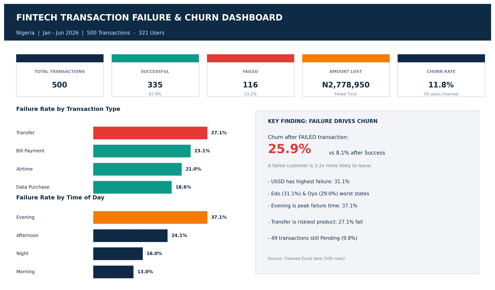
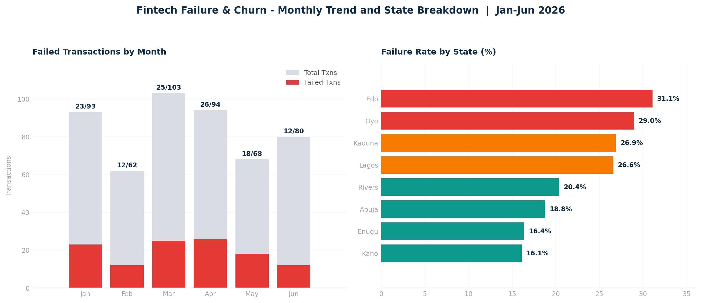

# Fintech-Failure-Churn-Analysis-Nigeria-2026

# Fintech Transaction Failure & Churn Analysis - Nigeria (Jan - Jun 2026)

## by Kunle Solanke | HR & Data Analyst

### what is my project about?
This project looks at why customers stop using a fintech app in Nigeria. I analysed 500 transactions from 321 users between January and June 2026 to understand how failed transactions affect customer churn (when a customer leaves).

As an HR and Data Analyst, I did not just look at numbers. I also looked at the people side - how a bad experience makes a customer lose trust and leave, and what the company can do to keep them.

# what I did
- Cleaned messy data in Excel: I fixed different date formats, removed Naira symbols ( ₦ ), corrected spelling like "TRANSFER" / "transfer" / "Fail" / "Failed", and filled missing values.
- Created a clean dataset with 500 rows and built a dashboard that updates with formulas.
- Analysed failure rate, churn rate, transaction type, device, time of day, state, and month.

# key Findings
- 500 transactions:* 335 succeeded (67.0%), 116 failed (23.2%), and 49 were still pending (9.8%).
- money lost: ₦2,778,950 was lost to failed transactions.
-  hurn rate:* 11.8% of transactions ended in churn (59 users left).
- failure drives churn:* Customers who had a failed transaction churned at 25.9%, compared to only 8.1% for customers with a successful transaction. That means a customer is *3.2 times more likely to leave after a failure.*
- transfers are the riskiest:* Transfer failed the most at 27.1%, followed by Bill Payment at 23.1%, Airtime at 21.0%, and Data Purchase at 18.6%.
- evening is the worst time:* 37.1% of evening transactions failed, compared to only 13.0% in the morning.
- USSD fails the most:* USSD had a 31.1% failure rate, higher than Android (24.5%) and iOS (16.1%).
- Location matters:* Edo had the highest failure rate at 31.1%, followed by Oyo at 29.0%. Kano had the lowest at 16.1%.
- Worst months:* March (25 failed) and April (26 failed) had the highest failures. It improved in May and June.

# What this means - HR & People View
In HR, we say people do not leave a company because of one small mistake, they leave because they lose trust. It is the same with customers.

When a transfer fails, especially in the evening when people need money urgently, the customer feels stressed and embarrassed. If no one explains what happened or refunds them quickly, they will move to another app. That is why churn is so high after failure.

Complaints alone did not explain churn (13.2% churn with complaint vs 11.3% without). This shows many unhappy customers do not even complain, they just quietly leave. That is a big risk for the company.

# Recommendations
- fix Transfers and USSD first:* These two have the highest failure. The tech team should check network and bank connection issues.
- focus on Evening:* Add more system capacity and support staff in the evening when failures peak.
- Act fast after a failure:* Send an automatic apology, explain the problem, and refund quickly. Follow up with the customer within 24 hours.
- clear the Pending transactions:* 49 pending transactions should be resolved quickly, because pending creates the same fear as failure.
- support Edo and Oyo:* Check network partners in those states.
- Train support team:* HR should trainsupport staff on empathy, clear communication, and fast resolution. One good recovery can keep a customer.

# Conclusion
The main conclusion is simple: *Failed transactions are not just a technical problem, they are a people and trust problem.

The company is not losing customers because customers do not like the product. It is losing them because the product fails when they need it most. If the company reduces failures, especially for Transfers, USSD, and evening transactions, and responds quickly when failure happens, churn will go down, trust will go up, and revenue will grow.

Good service is not just about fixing the system. It is about making the customer feel valued even when something goes wrong.

# Tools Used:
Microsoft Excel (Data Cleaning, Formulas, Dashboard), Data Analysis

# files in this repo:
`Fintech_Failure_Churn_Analysis_Nigeria_2026.xlsx` - Dirty data, Clean data, Dashboard
- `dashboard_main.png` - Main dashboard
- `dashboard_breakdown.png` - Monthly and State breakdown
